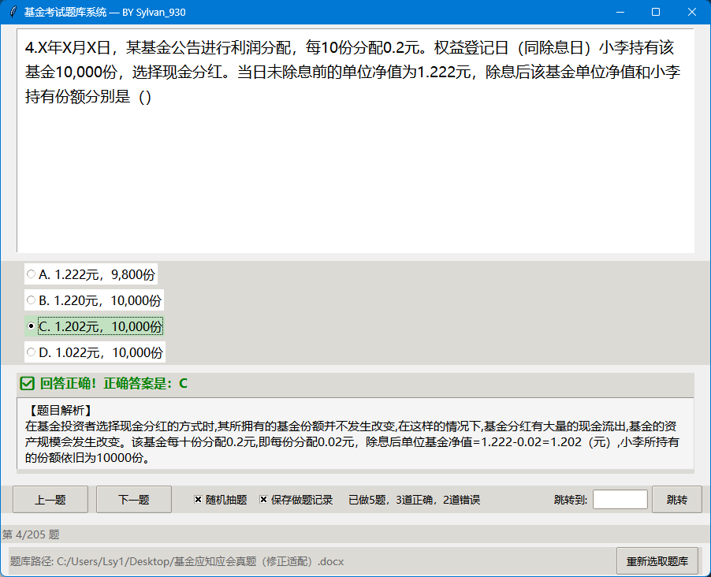

# 基金考试题库系统

## 项目介绍
这是一个简单而实用的选择题题库测试系统，专为**基金从业资格考试、银行内部资格认证**等考试设计。项目的初衷是帮助金融从业人员高效应对各类资格考试和知识测评，现在也可用于其他类型满足格式要求的选择题题库。

### 为什么需要这个系统？
当面对银行或金融机构的各类考试时，我们通常会遇到这些问题：
- 题库资料分散在各种文件格式中（Word、TXT等）
- 考前需要反复练习，但缺乏随机抽题和统计功能
- 机构内部考试系统功能单一，不支持自定义题库导入
- 考前突击需要高效记忆答案和解析

本系统解决了这些问题，支持多种文件格式的题库导入，可以进行随机抽题、答案记录和成绩统计，让考试准备更加高效和针对性。



## 功能特点

- **文件选择**：使用系统文件选择器直接选择任意题库文件
- **多格式支持**：支持解析 `.docx`、`.txt` 和 `.csv` 等多种格式的题库文件
- **智能解析**：自动识别题目、选项和答案
- **随机抽题**：支持顺序或随机模式答题
- **答题记录**：可选择是否保存答题记录
- **成绩统计**：提供已答题数、正确率等实时统计
- **题目跳转**：支持直接跳转到指定题号

## 软件架构
本项目采用MVC（Model-View-Controller）架构模式设计：
- **Model**：处理数据和业务逻辑
  - `models/question.py`：题目模型
  - `models/question_bank.py`：题库管理模型
- **View**：用户界面相关
  - `views/app_view.py`：主应用视图
  - `views/components/`：UI组件（题目、反馈、导航等）
- **Controller**：控制程序流程
  - `controllers/app_controller.py`：主控制器
- **Services**：提供特定功能服务
  - `services/file_service.py`：文件操作服务
  - `services/parser_service.py`：文件解析服务
- **Utils**：工具类
  - `utils/logger.py`：日志工具
  - `utils/text_utils.py`：文本处理工具

## 安装教程

1. 克隆或下载本仓库到本地
```
git clone [仓库地址] [项目路径]
```

2. 安装依赖

使用 uv（包含构建依赖）：
```bash
cd [项目路径]
uv sync --group build
```

**依赖说明**：
- `python-docx`：用于解析Word文档格式的题库文件
- `lxml`：XML解析库，python-docx的依赖项
- `pillow`：图像处理库，处理题库中的图片内容

3. 直接运行
```bash
python main.py
```

4. 构建可执行文件

**使用构建脚本**
```bash
python build.py
```

**手动构建**
```bash
# 直接使用PyInstaller命令行参数构建
pyinstaller --onefile --windowed --name="基金考试题库系统" --icon=icon.ico --clean --hidden-import=docx main.py
```

### 构建脚本功能
- **自动清理**：清理所有垃圾文件和构建缓存
- **依赖检查**：检查构建依赖是否已安装
- **智能构建**：使用优化的参数构建单文件exe
- **后处理**：构建完成后自动清理临时文件

### 构建输出
- 可执行文件位置：`dist/基金考试题库系统.exe`
- 文件大小：约 20-30 MB
- 运行环境：Windows 7/8/10/11，无需安装Python

### 构建脚本功能详解

#### 自动清理功能
- 清理 `__pycache__` 缓存目录
- 清理 `build/`、`dist/` 构建目录
- 清理 `.pyc`、`.pyo`、`.pyd` 编译文件
- 清理 `.pytest_cache`、`.mypy_cache` 等工具缓存
- 清理 `.log` 日志文件

#### 依赖检查
- 自动检查 PyInstaller 是否安装
- 检查核心依赖模块（docx、lxml、PIL）
- 缺失依赖时自动安装

#### 智能构建
- 使用优化的 PyInstaller 参数
- 自动包含隐式导入模块
- 生成单文件可执行程序
- 包含程序图标和版本信息

#### 构建参数说明
```bash
pyinstaller \
    --onefile \                    # 打包成单个文件
    --windowed \                   # 窗口模式，不显示控制台
    --name=基金考试题库系统 \        # 输出文件名
    --icon=icon.ico \              # 程序图标
    --clean \                      # 清理临时文件
    --noconfirm \                  # 不询问覆盖
    --hidden-import=docx \         # 隐式导入docx模块
    --hidden-import=docx.shared \  # docx子模块
    --hidden-import=lxml \         # lxml模块
    --hidden-import=PIL \          # Pillow模块
    --distpath=dist \              # 输出目录
    --workpath=build \             # 工作目录
    main.py                        # 主程序文件
```

### 构建后文件结构
```
项目根目录/
├── dist/
│   └── 基金考试题库系统.exe  # 最终可执行文件
└── build/                   # 临时构建文件（自动清理）
```

## 使用说明

1. 启动程序后，系统会弹出文件选择对话框，选择您的题库文件
2. 题库加载成功后，显示第一道题目，开始答题
3. 点击选项选择答案，系统会即时给出正确答案和解析
4. 使用"上一题"、"下一题"按钮或跳转功能浏览题目
5. 可选择"随机抽题"和"保存做题记录"等设置
6. 使用右下角"重新选取题库"按钮可随时切换不同的题库文件

## 题库文件格式要求

系统支持以下格式的题库文件：
- Word文档(.docx)
- 文本文件(.txt)
- CSV文件(.csv)
- 其他文本格式文件

题库文件内容需满足一定的格式要求，例如：
```
1. 这是一道单选题？
A. 选项A
B. 选项B
C. 选项C
D. 选项D
答案：A
解析：这是解析内容

2. 这是第二道题...
```

## 故障排除

### 常见问题

1. **构建失败：找不到模块**
   - 确保所有依赖已正确安装
   - 运行 `uv sync --group build` 确保依赖同步

2. **可执行文件无法运行**
   - 检查是否缺少隐式导入模块
   - 在构建脚本中添加更多 `--hidden-import` 参数

3. **文件过大**
   - 使用 `--exclude-module` 排除不需要的模块
   - 考虑使用 UPX 压缩优化文件大小

4. **运行时错误**
   - 检查资源文件路径
   - 确保所有必要的数据文件已包含

### 调试模式构建
如需调试，可以启用控制台模式：
```bash
pyinstaller --onefile --console --name="基金考试题库系统-调试版" main.py
```

## 分发建议

1. **单文件分发**: 直接分发 `基金考试题库系统.exe`
2. **打包分发**: 将 exe 文件与说明文档一起打包为 zip
3. **版本管理**: 在文件名中包含版本号，如 `基金考试题库系统_v1.0.exe`

## 更新维护

当代码更新后，重新构建：
```bash
# 清理旧的构建文件并重新构建
python build.py
```

构建脚本会自动处理清理和重新构建的全过程。

## 许可证

请查看项目中的LICENSE文件
